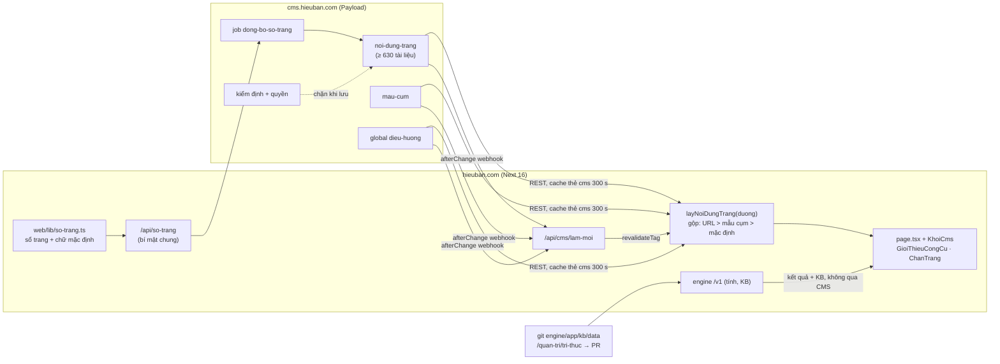

# Sửa nội dung mọi trang từ CMS — "Lớp phủ nội dung theo URL" (ND, đề xuất 2026-10-13)

> **Đẩy khâu:** 1 · Thu hút (sửa tiêu đề/mô tả/giới thiệu trang công cụ theo số GSC mà không chờ code) và
> 2 · Trải nghiệm → 4 · Mời → 5 · Nạp Sao (banner, video, lời mời đặt đúng chỗ trên trang người dùng đang dùng).
> **Đo bằng:** GSC CTR theo URL trước/sau khi sửa, `landing_viewed → reading_started`, sự kiện mới `cms_khoi_bam`
> (bấm banner/nút CMS) → `referral_signup` / `share_clicked` / mở `/nap-sao`. **Trạng thái: ĐỀ XUẤT, chờ anh duyệt**
> (mục 7). Chưa sửa dòng code nào; mọi đổi schema CMS là migration Payload có up/down, chỉ chạy sau khi anh duyệt.

Anh hỏi: *"Global Điều hướng chân trang chỉ sửa được chữ của link, loại link, đường dẫn. Em muốn sửa NỘI DUNG của từng
URL như một CMS thật: chữ, cỡ chữ, thêm banner, video… Ví dụ nội dung các URL ở chân trang sửa thế nào?"*

Trả lời ngắn: hôm nay **không sửa được**, vì chữ của các trang đó nằm trong code (`web/app/**/page.tsx`) hoặc do engine
dựng từ kho tri thức (git). Em đề xuất thêm **một collection "Trang website"** trong CMS: mỗi URL công khai là một dòng
(tự đồng bộ, anh không phải nhập), mỗi dòng có các **ô nội dung cố định** (SEO, đầu trang, giới thiệu, hỏi đáp, khối
trên/dưới kết quả: banner, video, đoạn văn, nút mời…). Ô nào anh để trống → web hiện đúng chữ đang chạy trong code.
Không đổi cấu trúc URL, không đụng engine, không chuyển kho tri thức vào CMS.

---

## 1. Hiện trạng (đã kiểm trong code 2026-10-13)

### 1.1 CMS đang quản gì

| Thứ | Ở đâu | Sửa được |
|---|---|---|
| Bài viết, chuyên mục, tác giả, ảnh | collections `bai-viet`, `chuyen-muc`, `tac-gia`, `media` | toàn bộ nội dung bài |
| Trang đích `/su-kien/{slug}` | `cms/src/collections/TrangDich.ts` (6 khối: đầu trang, thẻ công cụ, danh sách bài, hỏi đáp, lời mời, đoạn văn) | toàn bộ |
| Menu đầu trang | global `menu-dau-trang` | nhãn + link |
| Chân trang | global `dieu-huong` (`cms/src/globals/DieuHuong.ts`) | **chỉ** tên cột + nhãn/loại/đường dẫn link |
| Dải thông báo, banner trang chủ, khối bài mới, bài theo mảng | global `trang-chu` | chữ, ảnh, nút, khung ngày |
| Công tắc nội dung | global `tinh-nang` | bật/tắt |

Khối Lexical dùng lại được: `cms/src/blocks/index.ts` — `ghi_chu`, `keu_goi`, `trich_dan`, `video` (YouTube, phát qua
youtube-nocookie). Web đọc CMS qua `web/lib/cms.ts` (`goiCms`: hạn 4 giây, `revalidate: 300`, thẻ `cms`), lọc HTML bằng
`web/lib/cms-html.ts` (allowlist, iframe chỉ youtube-nocookie, bỏ thuộc tính `style`), webhook `/api/cms/lam-moi` xoá
thẻ `cms`, xem trước `/api/cms/xem-truoc?slug&ma=HMAC` (hiện chỉ cho bài blog).

### 1.2 Sổ URL công khai và chữ đang nằm ở đâu

Đếm: 20 URL tĩnh (`TINH` trong `web/app/sitemap.ts`) + 15 chủ đề + 496 trang KB + 1 + 92 trang tuổi + 6 lá số mẫu
= **630 URL do code/engine dựng** (gồm `/blog`), cộng bài blog, chuyên mục có bài và trang đích còn hạn (số 496 đếm từ
`engine/app/kb/trang.danh_sach()`: so 12 · que 64 · sao 14 · cung 12 · thap_than 10 · nhat_chu 10 · cap_so 45 ·
nghe 12 · tinh_yeu 12 · nam_ca_nhan 9 · no_nghiep 4 · sao_cung 168 · hoa_cung 48 · menh_nam 76; tất cả `index=true`).

**(A) Trang công cụ** — khung server `page.tsx` + component client do engine tính.

| URL | Chữ hiển thị nằm ở | CMS sửa được hôm nay | Engine/KB (KHÔNG chuyển vào CMS) |
|---|---|---|---|
| `/than-so`, `/tu-vi`, `/bat-tu`, `/kinh-dich`, `/phong-thuy`, `/hop-doi`, `/hom-nay` | `app/<mảng>/page.tsx`: hằng `ND: NoiDungCongCu` (mô tả SEO, 3 đoạn giới thiệu, 4 hỏi đáp, link đọc thêm) + `metaTrang({ tieuDe })`; H1 + lời dẫn trong component client (`app/tu-vi/TuVi.tsx` → `<DauMang ten mo_ta>`), câu nhắc phụ (vd "Mới làm quen Tử vi? Xem 6 lá số mẫu…") | chỉ khối "Bài viết liên quan" (`BaiLienQuanMang`, số bài) | kết quả tính, luận giải, hỏi đáp, khung "Trường phái" |
| `/ban-than` (hub hồ sơ) | `app/ban-than/page.tsx` (metadata) + `BanThan.tsx` | không | các con số + 3 lớp |
| `/nap-sao` | `app/nap-sao/page.tsx` + `NapSao.tsx` | không | gói/giá ở Supabase `goi_sao` (/quan-tri) |
| `/ung-ho`, `/tai-khoan`, `/dang-nhap`, `/chia-se`, `/nap-sao/ket-qua`, `/hop-doi/[ma]`, `/the/[ma]` | `page.tsx` từng trang; 5 trang sau `noindex` | không | ví/ngân hàng từ env; mã mời HMAC |

**(B) Trang tĩnh / giới thiệu / pháp lý**

| URL | Chữ nằm ở | Ghi chú |
|---|---|---|
| `/` | `app/page.tsx`: `TIEU_DE_CHU`, `MO_TA_CHU`, mảng `MANG` (mô tả 4 thẻ), lời dẫn | banner + bài mới đã ở CMS (`trang-chu`) |
| `/kham-pha` | `app/kham-pha/page.tsx` | khối bài mới đã ở CMS |
| `/gioi-thieu` | `app/gioi-thieu/page.tsx`: 7 mục `Muc[]` (su-menh, phuong-phap, quy-trinh, nguon, cam-ket, ung-ho, van-hanh) qua `components/phap-ly/TrangPhapLy.tsx` | mục "quy-trinh" nói về thẩm định — ràng buộc E-E-A-T |
| `/lien-he` | `app/lien-he/page.tsx` (mục `thong-tin`, `chu-de`) | email/điện thoại lấy env (`lib/van-hanh.ts`) |
| `/chinh-sach-rieng-tu` (175 dòng), `/dieu-khoan`, `/mien-tru-trach-nhiem` | `page.tsx` từng trang, `TrangPhapLy`; ngày hiệu lực = hằng `NGAY_HIEU_LUC` (`lib/van-hanh.ts`) | văn bản pháp lý |
| `/tac-gia`, `/tac-gia/duc-luan` | `lib/chuyen-gia.ts` (hồ sơ — "chỉ ghi điều chuyên gia đã công bố") + engine `/v1/kb/chuyen-gia` | E-E-A-T, không cho sửa tuỳ ý |
| `/kien-thuc`, `/la-so-mau`, `/tu-dien`, `/phong-thuy/huong-hop-tuoi` (trang mục lục) | lời dẫn trong `page.tsx`; danh sách từ engine | danh sách = KB |

**(C) Trang kiến thức dựng từ KB** — nội dung chính là KB (git), sửa ở `/quan-tri/tri-thuc` → PR.

| Mẫu URL | Số URL | Khung chữ cố định (code) | Phần KB |
|---|---|---|---|
| `/kien-thuc/{chu_de}` | 15 | `CHU_DE` trong `web/lib/kien-thuc.ts` (tên, mô tả) | danh sách trang |
| `/kien-thuc/{chu_de}/{slug}` | 496 | nhãn khung trong `app/kien-thuc/[chu_de]/[slug]/page.tsx` | tiêu đề, trả lời nhanh, mục, hỏi đáp, nguồn, góc nhìn, chữ ký (`tham_dinh.json`) |
| `/phong-thuy/tuoi-{năm}-{nam\|nu}` | 92 | `app/phong-thuy/[slug]/page.tsx` | toàn bộ do `luangiai/phongthuy_tuoi.py` dựng |
| `/la-so-mau/{slug}` | 6 | `app/la-so-mau/[slug]/page.tsx` | `luangiai/la_so_mau.py` |

**(D) Đã do CMS quản:** `/blog`, `/blog/{slug}`, `/blog/chuyen-muc/{slug}`, `/blog/rss.xml`, `/su-kien/{slug}`.
Lời dẫn đầu trang `/blog` vẫn trong `app/blog/page.tsx`.

**(E) Hệ thống — không đưa vào CMS:** `/api/*` (44 route), `/auth/callback`, `/quan-tri/*`, `/og`, `/md/[...duong]`,
`robots.ts`, `sitemap.ts`, `manifest.ts`, `/llms.txt`, `/indexnow.txt`, `/nap-sao/gia` (cổng thử, chỉ ngoài production).

### 1.3 Ví dụ của anh: chân trang

**Chữ cố định của chân trang** — cứng trong `web/components/khung/ChanTrang.tsx`:

| Đoạn | Hiện tại | Đề xuất |
|---|---|---|
| Lời giới thiệu thương hiệu | "Năm hệ thống văn hoá — thần số học, Tử vi, Bát tự, Kinh Dịch, Phong thuỷ — trong một hồ sơ…" | CMS (global `dieu-huong`, nhóm "Khối thương hiệu") |
| 3 cam kết dữ liệu | hằng `CAM_KET` (biểu tượng ShieldCheck / Server / Sparkles) | CMS: 3 dòng chữ, biểu tượng chọn trong danh sách cố định. **Cảnh báo khi sửa**: đây là cam kết quyền riêng tư, phải khớp `/chinh-sach-rieng-tu` |
| Lời miễn trừ ("Nội dung biên soạn từ thư tịch… chủ biên Đức Luân chịu trách nhiệm") | đoạn `<p>` cứng | CMS, chỉ Chủ biên; kiểm định chặn bỏ trống |
| Đường dây khẩn cấp 115 / 113 / 111 | cứng | **Giữ trong code** (an toàn người dùng, không để lỡ tay xoá) |
| Tên đơn vị, mã số, địa chỉ, email, điện thoại, link Bộ Công Thương, mạng xã hội | env qua `lib/van-hanh.ts` (mặc định "Hieu Ban Co Ltd · contact@hieuban.com") | **Giữ env** — thông tin pháp lý thật, đổi qua Vercel |
| Nhãn "Ủng hộ đội ngũ phát triển", dòng © | cứng | CMS (nhãn); © giữ code |

**Từng link chân trang → sau ND, nội dung nào của URL đó sửa được ở CMS** (mặc định `MENU_MAC_DINH`, trùng
`web/lib/menu-chan-trang.ts`):

| Cột | URL | Nhóm | Sửa được ở CMS sau ND | Vẫn ở nơi khác |
|---|---|---|---|---|
| Khám phá | `/than-so` `/tu-vi` `/bat-tu` `/kinh-dich` `/phong-thuy` `/hop-doi` | A | tiêu đề/mô tả SEO, ảnh chia sẻ, H1 + lời dẫn, khối trên/dưới kết quả, 3 đoạn "Về công cụ", hỏi đáp (FAQPage), link đọc thêm | kết quả tính, luận giải (engine) |
| Kiến thức | `/kien-thuc` | B | lời dẫn, SEO, khối trên/dưới danh sách | danh sách chủ đề |
| | `/kien-thuc/than-so` `/kien-thuc/kinh-dich` `/kien-thuc/tu-vi` `/kien-thuc/hop-so` | C (chủ đề) | tên + mô tả chủ đề (thay `CHU_DE`), khối thêm | danh sách trang con (KB) |
| | `/tu-dien` `/la-so-mau` `/phong-thuy/huong-hop-tuoi` | B | lời dẫn, SEO, khối thêm | mục từ / lá số / danh sách tuổi (engine) |
| | `/blog` | D | lời dẫn đầu trang (mới) | bài: đã ở CMS |
| Về chúng tôi | `/gioi-thieu` (+ `#nguon`) | B | từng mục theo neo (id giữ nguyên để link `#nguon` không gãy) | mục "quy-trinh": chỉ Chủ biên |
| | `/tac-gia/duc-luan` | B | **không** (hồ sơ E-E-A-T, đổi bằng PR `lib/chuyen-gia.ts`) — chỉ thêm khối dưới | số trang thẩm định (engine) |
| | `/lien-he` (+ `#chu-de`) | B | mục `chu-de`, lời dẫn | email/điện thoại (env, chèn bằng biến `{email}`) |
| | `/tai-khoan` `/nap-sao` | A | lời dẫn, khối thêm (vd banner chiến dịch nạp) | gói, giá, số dư (Supabase) |
| Pháp lý | `/chinh-sach-rieng-tu` (+ `#quyen`) `/dieu-khoan` `/mien-tru-trach-nhiem` | B-pháp lý | từng mục theo neo + ngày hiệu lực; chỉ Quản trị/Chủ biên xuất bản | thông tin đơn vị (env) |

---

## 2. Phương án kỹ thuật

| Tiêu chí | 1. Dời mọi trang thành "page builder" Payload | **2. Lớp phủ nội dung theo URL (chọn)** | 3. Sửa trực quan / live preview toàn site | 4. Để chữ ở `/quan-tri` (Supabase) |
|---|---|---|---|---|
| Cách làm | Mỗi trang = tài liệu CMS ghép khối; web render toàn bộ từ CMS | Mỗi URL = 1 dòng CMS với **ô cố định**; web render khung + kết quả như cũ, chỉ lấy chữ ở ô có nội dung, ô trống dùng mặc định trong code | Payload Live Preview / click-to-edit trên chính trang web | Bảng `noi_dung_trang` trong Supabase, form ở /quan-tri |
| Rủi ro SEO / cấu trúc | **Cao**: 630 URL đổi nguồn render, dễ mất H1, schema, `GioiThieuCongCu`, rà SEO-E | **Thấp**: URL, H1, JSON-LD, sitemap giữ nguyên; ô SEO có giới hạn độ dài như SEO-E | Trung bình: cần bọc mọi đoạn chữ bằng thuộc tính sửa | Thấp |
| Rủi ro engine | Cao: trang công cụ là client component gọi engine — không "khối hoá" được | **Không**: kết quả tính không đi qua CMS | Trung bình | Không |
| Công sức | nhiều tuần | ~13–16 ngày công, chia 7 pha | lớn (Live Preview cần web nhúng trong iframe admin → nới `frame-ancestors`, cookie draft) | trung bình, nhưng phải tự viết trình soạn, phiên bản, xem trước |
| Bảo mật | HTML từ CMS ở mọi nơi | Ô văn bản thuần + rich text qua `locHtmlCms` + khối định kiểu; link chỉ trong site (`DUONG_TRONG_SITE`) | phải mở CSP `frame-ancestors` cho cms.hieuban.com | tốt (MFA) |
| BM-1, kiểm định | phải viết lại | dùng lại luật `kiem-dinh.ts` (vùng cấm, liên hệ, tên nội bộ) | không có chỗ chặn trước khi lưu | phải viết lại |
| E-E-A-T | dễ sửa nhầm chữ ký | ô chữ ký/thẩm định **không có trong CMS** | dễ sửa nhầm | như 2 |
| Hiệu năng | mỗi trang phụ thuộc CMS | 1–2 fetch có cache thẻ `cms` (300 s, hết hạn vẫn trả bản cũ trong lúc làm mới) | thêm script admin trên trang | thêm truy vấn Supabase mỗi trang |
| Quay lui | khó (dữ liệu đã dời) | xoá/unpublish dòng → web về chữ trong code; Payload giữ phiên bản | trung bình | tự viết |
| Đúng phân vai mục 0 `KIEN-TRUC-CMS.md` | đúng | **đúng** (chữ/hình người đọc thấy → CMS) | đúng | **sai** (chữ hiển thị thuộc CMS) |

**Chọn phương án 2** vì: (1) không đụng 4 tầng — CMS chỉ thêm chữ quanh kết quả, không tính, không chạm KB;
(2) có "lưới an toàn" sẵn: ô trống = code default, CMS sập = trang như hôm nay; (3) dùng lại mọi thứ đã có (khối
Lexical, `locHtmlCms`, kiểm định, webhook, HMAC xem trước, phiên bản Payload, vai trò); (4) cho anh đúng cảm giác
"CMS thật": mọi URL có trong danh sách, bấm vào là sửa. Phương án 3 (live preview) để sau, làm **trên** phương án 2
khi cần (mục 7, câu 6).

---

## 3. Thiết kế chi tiết

### 3.1 Hai collection mới (nhóm "Giao diện website")

**`noi-dung-trang`** — label "Trang website", mỗi URL một tài liệu.

| Trường | Kiểu | Ghi chú |
|---|---|---|
| `duong` | text, unique, **chỉ đọc** | `/tu-vi`, `/kien-thuc/sao-cung/tu-vi-cung-menh`… (do đồng bộ tạo) |
| `nhom` | select, chỉ đọc | `cong_cu` · `tinh` · `phap_ly` · `chu_de` · `kien_thuc` · `tuoi` · `la_so_mau` · `blog_khung` |
| `ten` | text, chỉ đọc | tên trang lấy từ sổ trang (để tìm) |
| `mau` | relationship → `mau-cum` | chỉ nhóm C |
| `tren_web` | checkbox, chỉ đọc | đồng bộ thấy URL còn trên web; mất → `false` + nhãn "URL đã gỡ" (không tự xoá) |
| `mac_dinh` | json, chỉ đọc | chữ đang chạy trong code cho từng ô (để anh xem/chép, không phải gõ lại) |
| tab **SEO** | `tieu_de_seo` (≤ 70, kiểm như `tieuDeSeo`), `mo_ta_seo` (≤ 160), `anh_chia_se` (upload) | chỉ nhóm A, B, chủ đề |
| tab **Đầu trang** | `h1`, `loi_dan` (textarea), `kieu_chu` (mục 3.3) | H1 trang KB lấy từ engine → ô ẩn ở nhóm C |
| tab **Giới thiệu & hỏi đáp** | `doan[]` (≤ 6), `hoi_dap[]` (≤ 10 → FAQPage), `lien_ket[]` (dùng `truongLienKet`) | thay `ND` của `GioiThieuCongCu` |
| tab **Mục văn bản** | `muc[]` {`id` neo — chỉ đọc nếu đã có, `tieu_de`, `noi_dung` (Lexical)} | trang giới thiệu/pháp lý/liên hệ; `ngay_hieu_luc` cho pháp lý |
| tab **Khối thêm** | `khoi_tren` / `khoi_duoi` / `khoi_cuoi` (blocks, ≤ 6 mỗi vị trí) | vị trí cố định, mục 3.2 |
| sidebar | `_status`, `tu_ngay`/`den_ngay` cho khối, `nguoi_sua`, `ghi_chu_noi_bo` | phiên bản `maxPerDoc: 30`, nháp tự lưu, hẹn giờ xuất bản (như `TrangDich`) |

**`mau-cum`** — label "Mẫu cụm trang" (≈ 18 tài liệu: 15 chủ đề + tuổi + lá số mẫu + chủ đề chung).
Trường: `mau_duong` (vd `/kien-thuc/sao-cung/{slug}`, chỉ đọc), `bien` (danh sách biến web cấp, chỉ đọc, vd
`{tieu_de}`, `{ten_sao}`, `{ten_cung}`, `{nam}`), `khoi_tren` / `khoi_duoi` / `khoi_cuoi`. Chữ trong khối được dùng
`{bien}`; web thay bằng giá trị engine đã trả cho đúng trang, **thoát HTML trước khi thay**, biến lạ → giữ nguyên chữ.

**Thứ tự ưu tiên** (từ cao xuống): dòng `noi-dung-trang` của chính URL (ô có nội dung) → `mau-cum` của cụm → mặc định
trong code. Từng **ô** xét riêng; khối mỗi vị trí chọn một trong ba: "thay mẫu" / "thêm sau mẫu" / "ẩn mẫu ở trang này".

### 3.2 Ô theo nhóm trang

| Nhóm | SEO | Đầu trang | Giới thiệu + FAQ | Mục văn bản | Khối thêm (vị trí) | Ai xuất bản |
|---|---|---|---|---|---|---|
| A công cụ (7 trang + /ban-than, /nap-sao, /tai-khoan, /ung-ho) | ✅ | ✅ `h1`, `loi_dan`, câu nhắc phụ | ✅ (7 trang có `GioiThieuCongCu`) | — | `tren_ket_qua` (dưới đầu trang, trên form), `duoi_ket_qua` (trên "Bài viết liên quan"), `cuoi` | Chủ biên |
| B tĩnh (/, /kham-pha, /kien-thuc, /la-so-mau, /tu-dien, /huong-hop-tuoi, /blog, /lien-he) | ✅ | ✅ | — | /lien-he | `tren`, `duoi`, `cuoi` (trang chủ: giữa các thẻ mảng) | Chủ biên |
| B giới thiệu (/gioi-thieu) | ✅ | ✅ | — | ✅ 7 mục, mục `quy-trinh` khoá cho Chủ biên | `cuoi` | Chủ biên |
| B pháp lý (3 trang) | ✅ | ✅ | — | ✅ + `ngay_hieu_luc` bắt buộc đổi khi sửa mục | không có khối quảng bá | **Quản trị hoặc Chủ biên**, ô xác nhận "đã đối chiếu pháp lý" |
| C chủ đề (15) | ✅ | ✅ tên + mô tả chủ đề | — | — | `tren`, `duoi` | Chủ biên |
| C trang KB (496 + 92 + 6) | ❌ (engine dựng từ KB) | ❌ | ❌ (FAQ là KB) | ❌ | `tren_tra_loi`, `duoi_noi_dung`, `cuoi` — qua **mẫu cụm** + ghi đè từng URL | Chủ biên |
| `/tac-gia/*` | ❌ | ❌ | — | ❌ | `cuoi` | Chủ biên |

Ở nhóm C, tài liệu CMS có nút **"Sửa nội dung kiến thức"** trỏ `/quan-tri/tri-thuc/<tệp>` (git → PR) — đúng quyết định
"KB là git". Banner/video đặt quanh, không xen vào giữa văn KB.

### 3.3 "Cỡ chữ" = lựa chọn có sẵn, không CSS tự do

Mỗi ô văn bản và mỗi khối có `kieu_chu`: **cỡ** `nho | thuong | lon | rat_lon`, **căn** `trai | giua`, **nền**
`khong | nhan (glass) | vang | ngoc`. Web ánh xạ sang lớp Tailwind có sẵn (vd `lon` → `text-lg sm:text-xl`).

Vì sao không cho gõ CSS/px:
1. **Hệ thiết kế**: site có 2 giao diện (Đêm sao / Giấy cổ) và màu theo token — mã màu tự gõ sẽ sai ở một giao diện.
2. **Truy cập**: cỡ chữ theo `rem` + tỉ lệ đã kiểm độ tương phản; px tự do phá phóng to và điện thoại 390 px.
3. **Bảo mật**: `locHtmlCms` đang bỏ thuộc tính `style`; mở ra thì CMS bị lộ tài khoản có thể phủ cả trang
   (`position:fixed`) để lừa người dùng. CSP `style-src` hiện có `'unsafe-inline'` nên **chỉ** bộ lọc đang chặn việc này.
4. **SEO**: H1 vẫn là H1 dù chọn cỡ nào — cỡ chữ không đổi cấp tiêu đề.

### 3.4 Kiểu khối

Dùng lại 4 khối Lexical (`ghi_chu`, `keu_goi`, `trich_dan`, `video`) + 6 khối của `TrangDich` (`dau_trang`, `cong_cu`,
`bai_viet`, `hoi_dap`, `van_ban`, `loi_moi`), thêm 3 khối mới:

| Khối mới | Trường | Ghi chú |
|---|---|---|
| `banner` | nhãn, tiêu đề, mô tả, ảnh, nút + link trong site, khung ngày | như banner `trang-chu`, dùng lại component `BannerTrangChu` |
| `van_ban_giau` | Lexical (H2–H4, danh sách, ảnh, bảng, đường kẻ) | qua `cms/src/lib/html.ts` → web `locHtmlCms` |
| `nut_moi` (CTA) | chữ, link trong site, kiểu (chính/phụ), sự kiện đo | ghi `cms_khoi_bam` vào PostHog |

Khối hỏi đáp chỉ xuất `FAQPage` ở trang **chưa có** FAQPage (trang công cụ đã có từ `GioiThieuCongCu` → gộp vào một).

### 3.5 Sổ trang — đưa mọi URL vào CMS tự động

```
web/lib/so-trang.ts      (mới) mục nhập cố định: {duong | mau, nhom, ten, o: [...ô cho phép], mac_dinh: {...}}
                          — mặc định CHUYỂN từ page.tsx sang đây (ND hằng của 7 trang, TIEU_DE_CHU, CAM_KET…),
                            page.tsx đọc lại từ đây → một nguồn, không lệch.
web/app/api/so-trang      (mới) trả sổ trang + mọi URL cụ thể (mucLuc, dsTuoiHuong, dsLaSoMau — như sitemap.ts);
                          bắt header bí mật CMS_WEBHOOK_SECRET (so thời gian hằng, như /api/cms/lam-moi).
cms job "dong-bo-so-trang" Payload jobs (đã có, cron Vercel 1 lần/ngày) + nút "Đồng bộ ngay" trên danh sách:
                          URL mới → tạo tài liệu trống (_status draft, không có nội dung = không ảnh hưởng web);
                          URL mất → tren_web=false; cập nhật `ten`, `mac_dinh`; KHÔNG ghi đè ô biên tập.
                          Chạy bằng Local API, context boQuaLamMoi (không bắn 600 webhook).
```

Trang mới thêm trong code chỉ cần một dòng ở `web/lib/so-trang.ts`; e2e kiểm mọi URL trong `TINH` của sitemap có mục
trong sổ (không sót). Danh sách CMS lọc theo nhóm, "đã có nội dung", "URL đã gỡ"; cột "Mở trang" và "Xem trước".

### 3.6 Nháp, xem trước, phiên bản, vai trò, kiểm định

- **Nháp / xem trước**: tổng quát hoá `/api/cms/xem-truoc` thành `?duong=/tu-vi&ma=HMAC("trang:" + duong)` (giữ dạng
  `?slug=` cũ cho bài). Bật draft mode → `layNoiDungTrang` đọc bản nháp bằng khoá Máy đọc, dải "Đang xem bản nháp",
  noindex — như blog hôm nay. `duong` phải khớp `DUONG_TRONG_SITE` trước khi chuyển hướng (không mở chuyển hướng tự do).
- **Phiên bản**: Payload versions (30 bản), so sánh, "khôi phục bản này". Gỡ xuất bản = web về mặc định ngay.
- **Vai trò** (`cms/src/access.ts`): Biên tập viên soạn nháp mọi nhóm trừ pháp lý; Chủ biên xuất bản A/B/C; nhóm
  pháp lý + mục `quy-trinh` của /gioi-thieu: chỉ Quản trị/Chủ biên sửa và xuất bản (điều kiện ở `access`, không chỉ ẩn
  nút); Cộng tác viên: không thấy collection; Máy đọc: đọc nháp khi xem trước.
- **Kiểm định khi lưu** (máy chủ, `beforeChange`): tách các luật đang có trong `cms/src/kiem-dinh/kiem-dinh.ts`
  (`CAM_CHAN`, `LIEN_HE_CHU`, `TEN_NOI_BO`, `NHAY_CAM`, `GIONG_PHAN`) thành hàm dùng chung `kiemRanhGioi(van)`; **lỗi
  chặn** không cho xuất bản (vùng cấm, số điện thoại/email gõ tay — dùng biến `{email}`, `{dien_thoai}` lấy từ env;
  tên nội bộ BM-1). Thêm: tiêu đề SEO ≤ 70, mô tả ≤ 160; H1 không trống nếu đã bật; link chỉ trong site; khối
  `loi_moi`/`nut_moi` cấm từ doạ và đếm ngược (SAO-2). Chuẩn hoá NFC như bài viết.
- **E-E-A-T**: collection **không có** trường tác giả/thẩm định/góc nhìn; chữ ký trang KB vẫn từ `tham_dinh.json`.
  Kiểm định chặn cụm "đã thẩm định", "chuyên gia … duyệt" trong ô tự do (tránh khai sai người kiểm duyệt — DX-1).

### 3.7 Tích hợp web

```ts
// web/lib/noi-dung-trang.ts (mới)
layNoiDungTrang(duong: string, bien?: Record<string, string>): Promise<NoiDungTrang>
//  = gộp(code mặc định từ so-trang, mau-cum (nếu có), tài liệu của URL)  — luôn trả đủ ô, không bao giờ null
```

- Đọc qua `goiCms` sẵn có, `revalidate: 300`, thẻ `cms` + `trang:<duong>`; hạn chờ **1,5 giây** (ngắn hơn bài: chạy trên
  mọi trang). Fetch cache của Next trả bản cũ trong lúc làm mới, nên CMS sập chỉ ảnh hưởng lần đầu sau khi cache trống,
  và khi đó trả mặc định code.
- `generateMetadata` của trang đọc ô SEO; `metaTrang()` giữ nguyên quy tắc (openGraph đầy đủ).
- `<KhoiCms vi_tri="tren_ket_qua" nd={nd} />` (server component): render khối đã lọc; client tool nhận `dau` /
  `khoiTren` dạng props ReactNode từ `page.tsx` (server) — client component không gọi CMS.
- `GioiThieuCongCu` nhận `nd.gioi_thieu` (đúng interface `NoiDungCongCu` hiện có).
- Chân trang: `KhungChanTrang` nhận thêm `gioiThieu`, `camKet`, `mienTru`; fallback Suspense giữ bản code.
- Bản `.md` (`app/md/[...duong]`) chèn đoạn chữ của khối `van_ban`/`van_ban_giau` để HTML ↔ MD cùng nội dung (SEO-D).
- Webhook `/api/cms/lam-moi` nhận thêm `duong` (kiểm `DUONG_TRONG_SITE`) → `revalidateTag("trang:" + duong)`.
- **CSP không đổi**: video đã cho `frame-src https://www.youtube-nocookie.com`, ảnh đã cho kho ảnh CMS.

### 3.8 Chân trang (mở rộng global `dieu-huong`)

Thêm vào `cms/src/globals/DieuHuong.ts`: nhóm `thuong_hieu` {`gioi_thieu` textarea ≤ 300, `cam_ket[3]` {chữ ≤ 120,
biểu tượng: chọn 1 trong 8 biểu tượng lucide có sẵn}}, `mien_tru` textarea ≤ 600 (bắt buộc, chỉ Chủ biên),
`nhan_ung_ho` ≤ 40. Và ô UI **"Sửa nội dung các trang trong chân trang"**: liệt kê mọi link đang có ở 4 cột → link
thẳng tới tài liệu `noi-dung-trang` tương ứng (link tới bài/chuyên mục → mở bài/chuyên mục). Mặc định code giữ ở
`ChanTrang.tsx`; e2e `so-lieu-ngoai.spec.ts` mở rộng kiểm khớp.

### 3.9 Migration

Payload migration có up/down trong `cms/src/migrations` (vd `2026xxxx_noi_dung_trang`): tạo 2 bảng + bảng phiên bản +
bảng khối trong schema `cms`, thêm cột cho global `dieu_huong`. Down xoá đúng các bảng/cột đó. **Không đổi Supabase
`public`**, không đổi engine. Chạy thử lên → xuống → lên trên DB trống trong CI (job `cms`), rồi mới để `vercel-build`
chạy trên DB thật — **sau khi anh duyệt**.

---

## 4. Kế hoạch triển khai

| Pha | Phạm vi | Tệp chính | Kiểm thử | Nghiệm thu đo được | Công | Khâu · chỉ số |
|---|---|---|---|---|---|---|
| **ND-0** nền | 2 collection, migration, sổ trang, `/api/so-trang`, job đồng bộ, `layNoiDungTrang` (chưa trang nào dùng) | `cms/src/collections/NoiDungTrang.ts`, `MauCum.ts`, `cms/src/jobs/dong-bo-so-trang.ts`, `web/lib/so-trang.ts`, `web/lib/noi-dung-trang.ts`, `web/app/api/so-trang/route.ts` | test đơn vị gộp ưu tiên + thay biến (thoát HTML); tích hợp: đồng bộ tạo/đánh dấu, không ghi đè; route từ chối sai bí mật | sau đồng bộ CMS có **≥ 630** tài liệu, `tren_web` đúng; web không đổi 1 byte HTML (so ảnh chụp e2e) | 3 ngày | nền móng |
| **ND-1** chân trang | mở rộng `dieu-huong`, lối tắt sửa trang | `DieuHuong.ts`, `ChanTrang.tsx` | e2e: sửa giới thiệu → web đổi ≤ 10 s; trống → bản code; `mien_tru` trống bị chặn | anh tự đổi 3 cam kết không cần code | 1 ngày | nền móng (tin cậy) |
| **ND-2** trang công cụ | 7 trang A + /ban-than, /nap-sao, /ung-ho: SEO, đầu trang, giới thiệu + FAQ, 3 vị trí khối | `app/<mảng>/page.tsx`, `DauMang` props, `KhoiCms.tsx`, `GioiThieuCongCu.tsx` | `kiem-tra-seo.mjs` **0 lỗi 0 cảnh báo**; e2e: banner + video hiện, không vi phạm CSP, đúng 1 H1, FAQPage không trùng | GSC CTR 7 trang (28 ngày trước/sau sửa tiêu đề); `cms_khoi_bam` | 3 ngày | 1 Thu hút (CTR) · 2 (`reading_started`) |
| **ND-3** trang tĩnh | /, /kham-pha, /kien-thuc, /la-so-mau, /tu-dien, /huong-hop-tuoi, /blog, /lien-he, /gioi-thieu (theo mục, giữ id neo) | `page.tsx` từng trang, `TrangPhapLy.tsx` nhận mục từ CMS | e2e: neo `#nguon`, `#chu-de` còn sống; số điện thoại gõ tay bị chặn | 100% chữ hiển thị nhóm B sửa được | 3 ngày | 1 · `landing_viewed` trang chủ → `reading_started` |
| **ND-4** pháp lý | 3 trang, ngày hiệu lực, quyền Quản trị/Chủ biên, ô xác nhận | `chinh-sach-rieng-tu`, `dieu-khoan`, `mien-tru-trach-nhiem` | tích hợp: Biên tập viên không lưu được; e2e: `NGAY_HIEU_LUC` lấy từ CMS | đổi chính sách không cần deploy, có lịch sử phiên bản | 2 ngày | nền móng (pháp lý) |
| **ND-5** cụm KB | 18 mẫu cụm + ghi đè từng URL, biến, khối quanh nội dung KB, `.md` | `app/kien-thuc/[chu_de]/**`, `phong-thuy/[slug]`, `la-so-mau/[slug]`, `app/md/[...duong]` | e2e: 1 mẫu áp đủ 168 trang sao-cung; ghi đè 1 URL thắng mẫu; "ẩn mẫu" hoạt động; MD có đoạn khối | một thao tác đặt CTA cho cả cụm; rà SEO 0 lỗi | 3 ngày | 1 → 2 (KB → công cụ: `landing_viewed` `/kien-thuc/*` → `reading_started`) |
| **ND-6** xem trước + đo | xem trước mọi URL, nút "Xem trước"/"Mở trang", sự kiện `cms_khoi_bam`, thẻ quản trị "trang có nội dung CMS" | `api/cms/xem-truoc`, `lam-moi`, `KhoiCms.tsx`, `/quan-tri/tang-truong` | e2e: mã sai 401, `duong` ngoài site 401; nháp không lộ khi chưa bật draft | khối mời/nạp có số bấm theo URL | 1–2 ngày | 4 Mời (`referral_signup`) · 5 Nạp (mở `/nap-sao`) |

Tổng ≈ **16–17 ngày công**. ND-0 → ND-1 → ND-2 là đủ để anh sửa chân trang + 7 trang công cụ; các pha sau độc lập.
Mỗi pha một PR, ghi dòng "Đẩy khâu", thêm dòng vào bảng quyết định CLAUDE.md, cập nhật mục 0 `KIEN-TRUC-CMS.md`.

---

## 5. Rủi ro và cách giảm

| Rủi ro | Giảm |
|---|---|
| Sửa tiêu đề SEO làm tụt thứ hạng | giới hạn độ dài, `kiem-tra-seo.mjs` trong CI; ghi `cap_nhat` để so GSC trước/sau; phiên bản để quay lui |
| CMS chậm/sập làm chậm mọi trang | hạn 1,5 s, cache trả bản cũ, mặc định code; Suspense cho khối dưới |
| Tài khoản CMS bị lộ → chèn nội dung độc | ô văn bản thuần, HTML qua `locHtmlCms`, link chỉ trong site, MFA (`CMS_BAT_BUOC_MFA=1`), không CSS tự do |
| Chữ CMS lệch với code mặc định (2 nguồn) | mặc định chỉ ở `web/lib/so-trang.ts`; CMS hiện `mac_dinh` chỉ đọc; ô trống = mặc định |
| Sửa nhầm cam kết/pháp lý | quyền Quản trị/Chủ biên, ô xác nhận, ngày hiệu lực bắt buộc, cảnh báo "phải khớp chính sách" |
| Khai sai người thẩm định (E-E-A-T) | không có trường chữ ký; kiểm định chặn cụm "đã thẩm định" |
| Biến mẫu cụm sai/thiếu | biến lạ giữ nguyên chữ + cảnh báo khi lưu; xem trước trên 1 URL mẫu trước khi xuất bản |
| URL đổi/gỡ để lại nội dung mồ côi | đồng bộ đánh dấu `tren_web=false`, không xoá; Chủ biên tự dọn |
| Dời mặc định từ `page.tsx` sang sổ trang gây hồi quy | ND-0 chỉ dời, so ảnh chụp HTML trước/sau = giống hệt |
| Trùng nội dung với KB (Google coi là mỏng/trùng) | kiểm trùng CG-6 chạy cho khối `van_ban`/`van_ban_giau` |

---

## 6. Luồng dữ liệu



---

## 7. Việc anh cần quyết định (trả lời có/không)

1. Duyệt **phương án 2** (lớp phủ theo URL) và thêm 2 collection `noi-dung-trang` + `mau-cum` vào CMS?
2. Duyệt **migration Payload** (schema `cms`, có down) cho ND-0 và ND-1 — chạy khi deploy CMS sau khi merge?
3. Đường dây khẩn cấp 115/113/111 và dòng © **giữ trong code**, không cho sửa ở CMS?
4. Thông tin đơn vị vận hành (tên, mã số, địa chỉ, email, điện thoại, Bộ Công Thương) **giữ ở env** như hiện tại?
5. Trang pháp lý: chỉ **Quản trị/Chủ biên** sửa và xuất bản, mỗi lần sửa bắt buộc đổi ngày hiệu lực?
6. Trang kiến thức KB: CMS **chỉ thêm khối quanh** nội dung (banner, video, đoạn biên tập, CTA), **không** sửa tiêu đề,
   trả lời nhanh, hỏi đáp của KB (vẫn sửa ở `/quan-tri/tri-thuc` → PR)?
7. Hồ sơ `/tac-gia/duc-luan` giữ trong code (đổi bằng PR), CMS chỉ thêm khối cuối trang?
8. "Cỡ chữ" chỉ là **4 cỡ + 2 kiểu căn + 4 nền** có sẵn, không gõ CSS/px?
9. Đồng bộ sổ trang **1 lần/ngày** (giới hạn cron Vercel Hobby) + nút "Đồng bộ ngay" là đủ?
10. Sửa trực quan trên trang (Live Preview, phương án 3) **để sau** ND-6, chỉ làm khi xem trước bằng link chưa đủ?
11. Làm theo thứ tự ND-0 → ND-1 → ND-2 trước (chân trang + 7 trang công cụ), các pha sau theo số GSC?

---

## 8. Quyết định của anh (2026-10-13) — bản điều chỉnh đã duyệt

Anh duyệt **phương án 2 theo bản điều chỉnh** sau (thay các điểm khác ở mục 3–4 nếu mâu thuẫn):

1. **Không tạo sẵn ~600 tài liệu cho trang kiến thức.** `noi-dung-trang` chỉ đồng bộ tự động các URL nhóm A, B,
   pháp lý và 15 trang chủ đề (≈ 40 URL). Trang KB (nhóm C) dùng **mẫu cụm** (`mau-cum`, ≈ 18 mẫu); muốn chỉnh riêng
   một URL thì tạo **ghi đè theo yêu cầu** (tài liệu `noi-dung-trang` với `nhom = kien_thuc`, `duong` kiểm thuộc một
   cụm có thật).
2. **Cầu nối CMS ↔ Kho tri thức:** mỗi mẫu cụm / ghi đè trang KB hiện **xem trước chỉ đọc** phần chữ KB của trang
   (lấy từ engine `/v1/kb/trang/{loai}/{slug}`) và nút **"Sửa nội dung này trong Kho tri thức"** mở
   `https://hieuban.com/quan-tri/tri-thuc/<tệp>` (cần token GitHub Q5). KB vẫn là git; CMS không lưu chữ KB.
3. **Pháp lý — hai loại sửa:** mỗi lần lưu chọn `loai_sua` = `sua_chu` (chính tả/định dạng, giữ `ngay_hieu_luc`) hoặc
   `thay_doi_noi_dung` (bắt buộc `ngay_hieu_luc` mới > ngày cũ, giữ phiên bản cũ để xem lại). Chỉ Quản trị/Chủ biên
   sửa và xuất bản. Thông báo người dùng khi đổi nội dung chính sách: hỏi luật sư (mục E VIEC-CUA-ANH).
4. **Cỡ chữ** = lựa chọn có sẵn (cỡ, căn, nền nhấn) + định dạng trong trình soạn; không CSS/px tự do.
5. **Chữ nhỏ trong công cụ** (nút, thông báo lỗi): để sau ND-5, dạng bảng khoá → chữ có giới hạn độ dài.
6. **Thứ tự:** ND-0 gọn + ND-1 chân trang → ND-2 bảy trang công cụ → ND-4 pháp lý → ND-3 trang tĩnh → ND-5 mẫu cụm.
   Video nhúng dạng "ảnh trước, bấm mới tải" để không làm chậm trang công cụ.
7. Câu 3, 4, 7, 9, 10 mục 7: theo đề xuất (115/113/111 và © giữ code; thông tin đơn vị giữ env; hồ sơ tác giả giữ
   code; đồng bộ 1 lần/ngày + nút "Đồng bộ ngay"; Live Preview để sau).

## 9. Tiến độ

| Pha | Trạng thái | Ghi chú |
|---|---|---|
| ND-0, ND-1 | xong (PR #94) | sổ trang, đồng bộ, chân trang |
| ND-2 | xong (2026-10-14) | 11 trang công cụ (`components/cms/TrangCongCu.tsx` + `DauCms`), /ban-than, /nap-sao, /ung-ho, /tai-khoan theo ô `o`. Chủ dự án giao làm ND-3 ngay sau ND-2 (đổi thứ tự mục 8.6: ND-4 pháp lý làm sau ND-3). |
| ND-3 | xong (2026-10-14) | /, /kham-pha, /kien-thuc, /la-so-mau, /tu-dien, /phong-thuy/huong-hop-tuoi, /blog, 15 chủ đề; /gioi-thieu, /lien-he sửa mục theo neo (`gopMucCms`). |
| ND-4 | xong (2026-10-19) | 3 trang pháp lý: SEO, H1, lời mở đầu, mục theo neo, ngày hiệu lực (`ngayHienThi`); ô `da_doi_chieu_phap_ly` bắt buộc mỗi lần xuất bản; không khối. |
| ND-5 | xong (2026-10-19) | ~600 trang KB: khối mẫu cụm + ghi đè (`che_do_mau`), biến chữ thuần (`thayBien` không thoát HTML nữa), `.md` có chữ khối (`mdKhoi`); khối mới **Ảnh**; mục văn bản cho chèn ảnh. Migration `20261019_032830_nd_4_5_anh_phap_ly`. |
| ND-6 | xong (2026-10-22) | nút "Xem trước" ở mọi Trang website + Mẫu cụm (link HMAC `xem-truoc:trang:<đường dẫn>`, draft mode, dải báo "Đang xem bản nháp" + nút thoát; mẫu cụm mở một URL ví dụ của cụm — `viDuMau`). Thẻ quản trị **"Trang có nội dung CMS"** ở `/quan-tri/tang-truong` (mục 10.1). |
| ND-7 đợt 1 | xong (2026-10-22) | "Chữ trên trang" (mục 10): trang chủ, /kham-pha, /kien-thuc, 11 trang công cụ, 6 cụm trang con (xem ngày tốt theo ngày/tháng, tuổi làm nhà, xông đất, hướng xấu năm, tác giả); thẻ chủ đề theo H1/lời dẫn trang chủ đề; sửa khối cuối trang tác giả; xoá mẫu cụm làm mới web ngay. Migration `20261021_235710_nd_7_chu_tren_trang`. |
| ND-7 đợt 2 | xong (2026-10-22) | Mục 10.1: "Hình trên trang" (hình lớn trang chủ, 4 biểu tượng mảng trang chủ, 5 thẻ /kham-pha, ảnh chia sẻ theo cụm), "Chữ dùng chung" (global — form hồ sơ, ô vào trang chủ, khung hỏi đáp, "Thử lại"), xem trước nháp (ND-6). Migration `20261022_012038_nd_7_dot_2_hinh_chu_chung`. |

## 10. ND-7 — "Chữ trên trang" (chủ dự án duyệt 2026-10-21)

**Vấn đề (audit 2026-10-21):** CMS mới sửa được "khung" (SEO, H1, lời dẫn, giới thiệu, hỏi đáp, khối, mục) — mọi chữ còn lại
(chip, tiêu đề mục, bảng so sánh, thẻ mảng, nhãn trong công cụ…) cứng trong code; ~400 trang con theo ngày/năm chưa có trong
CMS; trang tác giả khai ô "Khối cuối" mà web không hiện.

**Cách làm:** mỗi đoạn chữ cố định của trang có KHOÁ + chữ mặc định trong **bảng chữ** của trang (`web/lib/chu/*.ts` — nguồn
duy nhất, trang đọc chữ qua bảng: `taoChu(bang, nd.chu)` ở máy chủ, `useChu()` trong công cụ client qua `DauCms`). Sổ trang
gửi bảng cho CMS (`mac_dinh.chu`); CMS có tab **"Chữ trên trang"** (`cms/src/components/ChuTrenTrang.tsx`): mỗi dòng = chữ gốc
(chỉ đọc) + ô gõ chữ thay + bộ đếm + "Về chữ gốc", lưu ô json `chu` = { khoá: chữ }. Để trống = chữ gốc.

| Quy tắc | Chi tiết |
|---|---|
| Chữ thuần | CMS bỏ thẻ HTML, gộp dòng, cắt theo giới hạn từng khoá, bỏ khoá lạ (`locChuCms`); web lọc lại lần hai (`locChu`). |
| Nhấn | `*đoạn*` → đoạn nhấn (màu/đậm do chỗ đặt quyết định — vd H1 trang chủ vàng nghiêng, lời dẫn đỏ son). |
| Biến | `{ten}`, `{ngay}`, `{nam}`… do web điền; biến lạ giữ nguyên chữ. |
| Kiểm định | Chữ trong ô `chu` chạy cùng luật ranh giới (liên hệ gõ tay, tên nội bộ BM-1, "đã thẩm định"…) → chặn xuất bản. |
| Mẫu cụm | Cụm có bảng chữ riêng (vd tiêu đề "Ngày {ngay} tốt hay xấu?" cho mọi trang ngày); ghi đè một URL nhận bảng của cụm, chữ URL thắng chữ cụm. |
| Ngoài phạm vi | Kết quả engine, chữ kho tri thức (sửa ở `/quan-tri/tri-thuc`), hồ sơ chuyên gia (E-E-A-T, PR `lib/chuyen-gia.ts`), thông tin đơn vị (env), tiêu đề trình duyệt + mô tả SEO của trang con theo ngày/năm. |

**Thêm chữ cứng mới vào một trang:** thêm khoá vào bảng chữ của trang → đọc bằng `c("khoá")` → đồng bộ CMS tự hiện dòng mới.
Trang công khai mới: khai trong `SO_TRANG` hoặc `MAU_CUM` (`e2e/noi-dung-trang.spec.ts` đọc `/sitemap.xml`, sót URL là đỏ).

**Nhóm mới `cong_cu_con`** (ghi đè, không có kho tri thức): `/xem-ngay-tot/thang-{thang}-{nam}`, `/xem-ngay-tot/{ngay}`,
`/xem-tuoi-lam-nha/{nam}/tuoi-{nam_sinh}`, `/tuoi-xong-dat/{nam}/tuoi-{nam_sinh}`, `/phong-thuy/huong-xau-nam/{nam}`,
`/tac-gia/{slug}` (chỉ khối cuối).

**Thẻ chủ đề:** tên + mô tả thẻ ở `/kien-thuc` và khối "Kiến thức {mảng}" của trang công cụ lấy theo H1 + lời dẫn đã xuất bản
của chính trang chủ đề (`layDauNhieuTrang`, một lần gọi CMS) — sửa một chỗ, mọi thẻ đổi theo.

### 10.1 Đợt 2 (2026-10-22) — hình, chữ dùng chung, xem trước

**Hình trên trang.** Bảng hình của trang (`BangHinh` trong `web/lib/chu/*.ts`: `HINH_TRANG_CHU`, `HINH_KHAM_PHA`; mẫu cụm có
`HINH_CUM` = ảnh chia sẻ) đi theo sổ trang sang CMS (`mac_dinh.hinh`). Tab CMS **"Hình trên trang"**
(`cms/src/components/HinhTrenTrang.tsx`) chỉ hiện khi trang có chỗ đặt hình: chọn ảnh thư viện / tải ảnh mới (bắt buộc mô tả
ảnh) / "Về hình gốc". Ô json `hinh` = { khoá: id ảnh }; khi lưu, hook `locHinh` bỏ khoá lạ và **chụp** {url, alt, cỡ ảnh} để
web không phải gọi thêm. Web: `AnhCmsHoac` — có ảnh CMS thì hiện ảnh, không thì hình vẽ SVG gốc; ảnh chia sẻ
(`chia_se`) thay ảnh Open Graph/Twitter của mọi trang trong cụm (`voiAnhChiaSe`), URL riêng thắng cụm. Chỉ nhận URL
`https://` hoặc đường dẫn trong site.

**Chữ dùng chung.** Global CMS **"Chữ dùng chung"** (`cms/src/globals/ChuChung.ts`, cùng giao diện "Chữ trên trang"): chữ lặp
ở nhiều trang — nhãn + nút form hồ sơ, ô vào trang chủ / chào lại, ô nhập + lỗi kết nối của khung hỏi đáp, nút "Thử lại".
Bảng `web/lib/chu/chung.ts` (`CHU_CHUNG`) đi theo sổ trang (`chung`); layout đọc một lần (`chuChungCms`) → context
`ChuChung` → `useChuChung()`. Cùng lọc + kiểm định như "Chữ trên trang".
**Đợt 3 (2026-10-22)** thêm 23 khoá: góp ý cuối bài (câu hỏi mặc định + 3 nút đo Gate 1 — mã đo `co/vua/khong` cố định,
chỉ chữ đổi), góp ý dưới câu trả lời thần số, kiểm chứng "Đúng với mình / Chưa đúng", nút chia sẻ (tên trên link, đang tạo,
gửi, chép link, tải ảnh story, chia sẻ thẻ hôm nay), "Vì sao nói vậy", "Tải ảnh" lá số / tứ trụ, "Thử lại" ở /ban-than và
hộp thoại Sao (hộp thoại nằm ngoài `<main>` → layout bọc thêm `ChuChung`). **Không** đưa vào CMS: câu cam kết dữ liệu (link
"không có ngày sinh", ô đồng ý lưu ghi chú, lời đồng ý lưu hồ sơ) và câu tỉ lệ "x% thấy đúng" — lời hứa về hệ thống, đổi
bằng PR như trang pháp lý.

**Xem trước bản nháp.** Nút "Xem trước" của Trang website / Mẫu cụm mở `/api/cms/xem-truoc?duong=…&ma=…` (HMAC
`xem-truoc:trang:<đường dẫn>`, `CMS_PREVIEW_SECRET`). Web chỉ nhận đường dẫn có trong sổ trang hoặc khớp mẫu cụm (mẫu cụm → URL
ví dụ), bật draft mode → `layNoiDungTrang` đọc bản nháp (không cache) → dải "Đang xem bản nháp" có nút thoát. Mã sai / đường
dẫn ngoài site → 401; nút thoát chỉ chuyển về đường dẫn trong site.

**Thẻ quản trị "Trang có nội dung CMS"** (`/quan-tri/tang-truong`, `lib/trang-cms-qt.ts`): mọi Trang website + Mẫu cụm đang
có nội dung ĐÃ XUẤT BẢN (bỏ tài liệu chỉ có ô hệ thống), mới sửa trước: phần đã sửa (SEO, Đầu trang, Giới thiệu, Mục, khối,
chữ, hình), ngày sửa gần nhất, link "Sửa" vào CMS, lượt bấm nút CMS 28 ngày (PostHog `cms_khoi_bam`, mẫu cụm = tổng các URL
khớp mẫu) và **Search Console 28 ngày trước ↔ từ ngày sửa** (nhấp/ngày + CTR; mẫu cụm lọc bằng regex cùng luật `regexMau`;
chỉ 25 dòng sửa gần nhất — hạn mức API). Kỳ sau < 7 ngày hoặc < 20 lượt hiển thị → ghi "chưa đủ số". Cache 1 giờ; thiếu khoá
Google / PostHog → ô hiện "—" kèm lý do.
